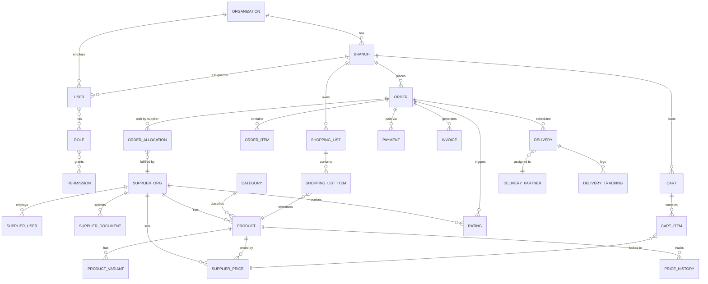

# GetbyFarm — Product Requirements & System Architecture

**Tagline:** "Smarter sourcing starts with GetbyFarm."

**Category:** B2B Procurement SaaS + Wholesale Marketplace + Group Buying + Supplier Management + Procurement Intelligence, for Kenya's hospitality/food-service industry (Africa-ready architecture).

Status legend used throughout: `[Implemented]` `[Mocked]` `[Requires 3rd-party API]` `[Future]`

---

## 1. Problem & Value Proposition

Hospitality buyers procure through fragmented channels (WhatsApp, phone, cash/M-Pesa, spreadsheets), causing poor price visibility, stock-outs, and weak reporting. GetbyFarm centralizes: list → compare → optimize → order → pay → track → analyze → reorder.

Core question the product must always answer:
> "What should I buy, from whom, at what price, in what quantity, and when?"

---

## 2. Business Model

- **Asset-light MVP**: suppliers own inventory & fulfillment; GetbyFarm owns tech, transaction layer, and procurement intelligence.
- Revenue: transaction commission, buyer subscriptions, supplier subscriptions (visibility/leads), delivery margin, enterprise SaaS.
- Future: GetbyFarm fulfillment hubs (Phase 3+).

---

## 3. Roles & Permissions (RBAC)

| Role | Scope | Key Permissions |
|---|---|---|
| **Buyer User** | Branch | create lists, cart, submit orders (below approval threshold), view own branch data |
| **Buyer Manager** | Branch | approve orders, manage branch users, view branch analytics |
| **Enterprise Admin** | Organization (all branches) | configure approval thresholds, consolidated analytics, manage branches/users |
| **Supplier Staff** | Supplier org | manage products/prices/stock, accept/dispatch orders |
| **Supplier Admin** | Supplier org | + verification submission, payout details, staff management |
| **Delivery Partner** | Assigned orders | update tracking status, proof of delivery |
| **Platform Admin** | Global | verify suppliers, manage commissions/categories, resolve disputes, refunds |

Permissions are modeled as `role -> permission` many-to-many (not hard-coded if/else), so new roles (e.g., country-specific compliance officer) can be added without code changes to the auth core.

---

## 4. Feature Map by Phase

### MVP (Phase 1)
Auth (JWT) · Organizations/Branches · Product Catalogue & Categories · Supplier Pricing · **Smart Procurement/Price Comparison Engine** · Multi-supplier Cart · Orders (draft→completed) · M-Pesa-ready payment abstraction (mocked) · Invoices · Basic delivery tracking · Admin dashboard · Basic analytics (spend, orders).

### Phase 2
Group buying (demand pools) · Inventory intelligence (reorder levels, days-remaining) · Subscription billing · Supplier ratings/reviews · Multi-branch consolidated management · Advanced analytics (savings, variance).

### Phase 3
AI demand forecasting · Automated replenishment · Price prediction · Logistics optimization · Financing partnerships · WhatsApp ordering.

---

## 5. System Architecture

```
┌─────────────────────────────┐
│   Next.js + TS + Tailwind   │  Web (buyer/supplier/admin portals)
└──────────────┬──────────────┘
               │ HTTPS/REST (JWT)
┌──────────────▼──────────────┐
│  Django + DRF (modular apps) │  Business logic, RBAC, Procurement Engine
│  - accounts, organizations   │
│  - catalog, suppliers        │
│  - procurement (engine)      │
│  - orders, payments, invoices│
│  - deliveries, analytics     │
└───┬───────────┬─────────────┘
    │           │
┌───▼───┐  ┌────▼─────┐   ┌───────────────┐
│Postgres│  │  Redis   │   │ Celery workers │  price refresh, forecasting,
│(primary)│  │(cache/  │   │ + beat         │  notifications, reorder jobs
│         │  │ queues) │   └───────────────┘
└─────────┘  └──────────┘
    │
┌───▼─────────────────┐   ┌────────────────────────┐
│ S3-compatible storage│   │ External integrations   │
│ (docs, product images)│  │ M-Pesa Daraja [3rd-party]│
└──────────────────────┘   │ SMS/Email [3rd-party]    │
                            │ eTIMS-ready [Future]     │
                            └────────────────────────┘
```

Design rules: no Kenya-specific logic hard-coded into core modules — `Country`, `Currency`, `TaxProfile`, `PaymentProvider`, `DeliveryProvider` are configurable entities so the same codebase serves Uganda/Tanzania/Rwanda/Ghana/Nigeria later.

---

## 6. Database ERD (core MVP entities)



Full field-level schema (SQL DDL) is in `docs/schema.sql`.

---

## 7. Smart Procurement Engine (core differentiator)

For each requested `(product, quantity)`, the engine scores every eligible `SupplierPrice` on:

```
score = w_price     * normalized(price)
      + w_delivery   * normalized(delivery_cost)
      + w_reliability* (1 - reliability_score)
      + w_quality    * (1 - quality_rating)
      + w_lead_time  * normalized(lead_time_days)
```

Lower score = better. Weights are configurable per-organization (a buyer who prioritizes speed over price can shift weights). The engine **never silently picks cheapest** — it always returns:

- Selected supplier
- Full breakdown of each candidate's score components
- A human-readable explanation string

This is implemented in `backend/procurement/engine.py` below, with unit tests, independent of Django so it can be reused by Celery jobs, the API, or a future WhatsApp bot.

---

## 8. API Surface (MVP)

```
/api/auth/            login, refresh, register
/api/organizations/    orgs, branches, users
/api/suppliers/        supplier org, verification, staff
/api/catalog/          categories, products, variants
/api/pricing/          supplier prices, price history
/api/procurement/      POST /recommend  (the engine)
/api/carts/            multi-supplier cart CRUD
/api/orders/           order lifecycle, allocations
/api/payments/         M-Pesa STK push [3rd-party, mocked in MVP]
/api/invoices/         invoice CRUD/PDF
/api/deliveries/       tracking
/api/analytics/        spend, savings, supplier performance
```

---

## 9. Folder Structure

```
getbyfarm/
├── docs/
│   ├── PRD.md
│   └── schema.sql
├── backend/
│   ├── manage.py
│   ├── config/                # settings, urls, celery.py
│   ├── accounts/               # users, roles, permissions, JWT auth
│   ├── organizations/          # orgs, branches
│   ├── suppliers/              # supplier org, verification, documents
│   ├── catalog/                # categories, products, variants
│   ├── pricing/                # supplier prices, price history
│   ├── procurement/            # engine.py (pure logic) + api views
│   │   └── tests/
│   ├── carts/
│   ├── orders/
│   ├── payments/               # mpesa/ abstraction (mocked adapter)
│   ├── invoices/
│   ├── deliveries/
│   └── analytics/
└── frontend/                   # Next.js app (Phase after backend MVP)
    ├── app/(buyer)/
    ├── app/(supplier)/
    ├── app/(admin)/
    └── components/
```

---

## 10. Implementation status (authoritative)

Legend: **Done** = implemented and covered by automated tests · **Done, unverified externally** = implemented to a
documented spec but not run against the real third party · **Not built**.

| Area | Status |
|---|---|
| Auth: register (buyer / supplier), JWT login, rotating + revocable refresh tokens, `/me`, role-based routing, rate limits | Done |
| RBAC: buyer roles, enterprise admin, supplier admin, platform staff; tenant isolation on buyer/supplier data | Done (tested, incl. mutation checks of the critical guards) |
| Supplier verification state machine (pending → review → verified / rejected / suspended), admin console | Done |
| Product catalogue + categories (50 starter products; admin-managed) | Done |
| Supplier listings (price, stock, MOQ, delivery fee, lead time), price history | Done |
| Procurement engine: landed cost + reliability + quality + lead time, explanations, exclusions | Done (pure-logic unit tests + API tests) |
| Multi-supplier cart, price lock, stale-price and stock checks at checkout, race-safe stock (row locks, proven on PostgreSQL) | Done |
| Approval chain (KSh 20k / 100k bands), role-checked approvers, no submit/pay bypass | Done (bands are platform-wide defaults; per-organisation config not built) |
| Order lifecycle derived from supplier progress; delivery records; buyer confirms receipt | Done |
| Stale unpaid-order expiry (releases reserved stock) | Done |
| M-Pesa STK Push: initiate, status polling, secret-path callback, amount/ID matching, idempotency, rounding | Done, **unverified against Safaricom** (needs credentials + sandbox run) |
| Invoices: generated on payment, listed to buyer | Done (no PDF; `etims_reference` placeholder only; tax = 0) |
| Dashboards: buyer, supplier, admin overview | Done |
| Production deploy: Docker images, compose, Caddy HTTPS + headers + IP allowlists, backups, CI | Done; **Docker images not built in the authoring environment**; Caddy behaviour tested with the real binary |
| Notifications | Records written in-app only; **no UI, no email/SMS/WhatsApp sending** |
| Group buying (demand pools) | Not built (landing page says "coming soon") |
| Inventory intelligence, forecasting, price intelligence UI | Not built (price-intelligence endpoint exists, no UI) |
| Subscriptions, commissions, supplier payouts | Not built |
| Supplier document upload / S3 storage | Not built (manual review) |
| Ratings, reviews, disputes, refunds, partial fulfilment/returns | Not built (manual via Django admin) |
| Password reset, email verification, 2FA, account lockout | Not built |
| Multi-branch management UI, enterprise HQ dashboard | Not built (model supports branches; signup creates one) |
| eTIMS integration, VAT calculation | Not built |
| Courier-partner integrations, routing/ETA | Not built |
| Reliability/quality computed from history | Not built (admin-set neutral prior at verification) |
| WhatsApp ordering | Not built |

### Security findings fixed during production hardening

A review of the earlier MVP found and fixed: unauthenticated M-Pesa callback that the mock adapter treated as paid;
buyers able to write supplier prices (cross-tenant); dashboard branch IDOR; supplier revenue visible to any user;
approval chain with no role checks and a submit bypass; payment initiation without order-state checks (double pay,
pay-before-approval); buyers able to set delivery status; branch creation in other organisations and self-service
subscription-tier changes; stock oversell race; unverified suppliers purchasable; per-process rate-limit counters;
rate limiting keyed on the proxy IP; ineffective Caddy IP allowlists. Each has a regression test or a verified runtime check.
